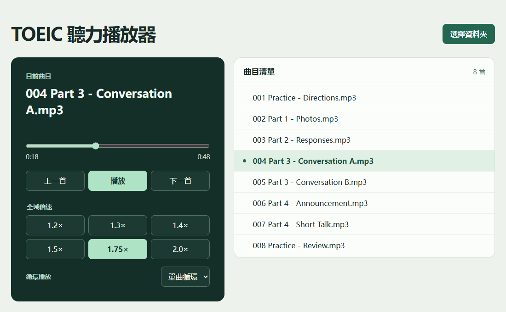

# TOEIC 聽力播放器

這是一款可離線使用的單一 HTML 播放器。匯入自己的 MP3，就能做多益聽力倍速練習。

## 介面預覽

截圖使用示範曲目。

## 使用方式

1. 下載 [`index.html`](index.html)，用 Chrome 開啟。
2. 按一下「選擇資料夾」，選取存放 MP3 的本機資料夾。
3. 點選曲目開始播放，或用「上一首」「下一首」切換曲目。切換曲目後會沿用目前的倍速。

## 功能

- 讀取所選資料夾及其子資料夾中的 MP3，依檔名的數字順序排列。
- 提供 **1.2×、1.3×、1.4×、1.5×、1.75×、2.0×** 六段全域倍速，並保留原本的音高。
- 可拖曳進度條，支援自動播放下一首、單曲循環及清單循環。
- 瀏覽器會在本機記住曲目、播放秒數、倍速與循環模式。使用同一個 Chrome 設定檔開啟相同路徑的 HTML，再選一次資料夾，即可還原。

## 隱私

HTML 可離線執行，播放器在瀏覽器中讀取本機音訊。音訊、曲目清單與播放進度都留在本機。儲存庫提供播放器程式碼與文件，使用時請自行準備音訊。

## 授權

本專案的程式碼採用 [MIT 授權條款](LICENSE)。
